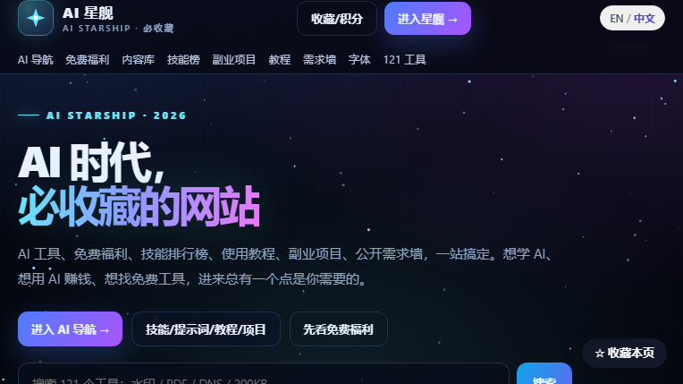

# AI 星舰 · AI Starship

> **AI 时代，一个真正能“从找方向到把事做完”的站点。**
>
> AI 工具导航 · 大模型榜 · API 调用榜 · 100 条技能 · 100 个副业项目 · 100 篇教程 · 100 条提示词 · 10 条业务一条龙 · MarkKit 本地工具

官网：**https://markkit.mengstone.com/**  
中文名：**AI 星舰**  
English：**AI Starship**  
自研工具品牌：**MarkKit**



---

## 这是什么

AI 星舰不是又一个“把 500 个 AI 网站堆成一页”的导航站。

它把 AI 使用拆成三层：

```text
找方向          看模型榜 / 工具榜 / 免费福利 / 副业项目
学方法          技能库 / 教程库 / 提示词库 / 会员 SOP
把事做完        10 条业务一条龙 + 121 个 MarkKit 本地工具
```

对程序员尤其有用：

- 选模型：综合榜、代码榜、长上下文、性价比、API 生态
- 看真实调用：OpenRouter 公开 token 处理量 Top 10
- 找工具：60 个 AI 工具官网入口，按对话/绘画/视频/音频/编程/办公/Agent 分类
- 学技能：100 条技能，每条拆 4 步、3 个检查点，带可复制提示词
- 做项目：100 个副业项目，写客户、交付物、成本/定价参考、获客、启动步骤和风险
- 跑业务：短剧、编程、电商、自媒体、求职、办公、学习、调研、设计、视频十条一条龙

---

## 一、模型排行榜：先选对模型，再谈提示词

AI 星舰的模型榜不是“谁给钱谁第一”，而是把不同使用场景拆开看：

| 榜单 | 看什么 | 适合谁 |
|---|---|---|
| 综合榜 | 通用能力、稳定性、生态 | 第一次选模型 |
| 代码榜 | 代码生成、调试、仓库理解 | 程序员 / 独立开发者 |
| 长上下文榜 | 长文档、长代码库、长对话 | 做 PDF / 代码库 / 资料分析 |
| 性价比榜 | 输入/输出价格与能力 | 要控成本的团队 |
| API 生态观察 | 模型可获取性、工具链、调用方式 | 要接 API 的开发者 |

> 榜单是编辑整理与公开资料观察，不是厂商官方排名，也不构成采购建议。  
> 价格、上下文长度、可用性会变，使用前请点官网核对。

### API 调用榜

- 基于 **OpenRouter 公开 token 处理量 Top 10**
- 只反映 OpenRouter 这一个公开切面，**不是全市场**
- 适合观察“开发者实际在调用什么”，不适合当成行业总量

### Token 费用对比

- DeepSeek 官方价
- 输入 / 输出 token 计算器
- 省钱方案与适用边界

对独立开发者来说，模型选错的成本不是“回答不好”，而是：

```text
贵 + 慢 + 上下文不够 + 工具链不可用 + 上线后不稳定
```

模型榜的价值，是先把这五项排除掉。

---

## 二、技能库：100 条“能直接照着做”的技能

技能库不是提示词大全，而是任务拆解库。

每条技能包含：

```text
适用场景
4 个执行步骤
3 个检查点
可复制提示词
常见误用
```

覆盖 10 类：

- AI 工具使用
- 写作 / 内容
- 图片 / 设计
- 视频 / 短剧
- 编程 / 开发
- 电商 / 运营
- 办公 / 效率
- 求职 / 职业
- 学习 / 研究
- 自动化 / Agent

### 为什么程序员会需要“技能库”

因为多数人卡住的不是“不会写 Prompt”，而是：

1. 不知道该把任务拆成几步
2. 不知道中间结果该检查什么
3. 不知道哪些环节必须人工确认
4. 不知道失败时该回退到哪一步

技能库把这四件事写死在每一条技能里，复制的是流程，不是一句“帮我写个代码”。

---

## 三、10 条业务一条龙：从需求到交付

这是 AI 星舰最不像普通导航站的部分。

不是给你 10 个工具，而是给你 10 条**从输入到交付**的完整链路：

| 一条龙 | 链路 |
|---|---|
| AI 短剧 | 选题 → 剧本 → 分镜 → 即梦/可灵 → 配音 → 剪辑 → 投放 |
| AI 编程 | 需求 → Trae/CodeBuddy/通义灵码/文心快码/WorkBuddy → 开发 → 测试 → 上线 |
| AI 电商 | 主图 → 详情 → 文案 → 视频 → 投放 → 交付检查与授权 |
| AI 自媒体 | 定位 → 选题 → 脚本 → 封面 → 七平台发布 → 复盘 |
| AI 求职 | 简历 → JD 匹配 → 作品集 → 面试 → Offer 比较（不编经历） |
| AI 办公 | 会议 → 周报 → Excel → PPT → 邮件 → 知识库（保密优先） |
| AI 学习 | 诊断 → 30 天计划 → 主动练习 → 项目 → 复盘 |
| AI 调研 | 检索 → 证据表 → 交叉验证 → 引用（不编来源） |
| AI 设计 | Brief → 情绪板 → 出图 → 排版 → 字体/肖像授权 |
| AI 视频 | 脚本 → 分镜 → 图生视频 → 配音 → 剪辑 → 交付 |

每条链路都标出：

- 输入是什么
- 中间产物是什么
- 哪些步骤必须人工判断
- 哪些素材涉及授权/版权
- 最后交付什么

对程序员来说，AI 编程一条龙尤其直接：  
不是“让 AI 写一段代码”，而是把需求、工具选择、开发、测试、上线串成一条可复用的工作流。

---

## 四、100 个副业项目库：不是“教你月入十万”

项目库列的是可核验的商业信息：

```text
客户是谁
交付物是什么
成本/定价参考
获客渠道
启动步骤
主要风险
```

它不承诺收益，也不卖“暴富课”。  
适合用来判断：

- 这个方向我能不能做
- 我需要补什么能力
- 获客成本大概多少
- 最坏情况会亏什么

---

## 五、100 篇教程 + 100 条提示词

教程库覆盖图片、PDF、内容、电商、办公，每篇 5 步操作 + 检查点。

提示词库每条包含：

- 完整 Prompt
- 变量说明
- 输入示例
- 输出结构
- 常见误用

不是“复制一句话就完了”，而是让你知道**变量怎么换、结果怎么验**。

---

## 六、AI 工具导航：60 个官网入口

按场景分类：

- 对话 / 推理
- 绘画 / 图片
- 视频 / 数字人
- 音频 / 配音 / 音乐
- 编程 / Agent
- 办公 / PPT / 表格
- 搜索 / 调研
- 创作 / 设计

只放官网入口，不提供共享账号，不卖“破解版”。

### AI 创作工具

5 个创作工具：

- 图标
- 宣传图
- ASO 文案
- 截图
- 其他创作素材

复制结果后跳官方工具生成。

---

## 七、MarkKit 自研工具：121 个，浏览器本地处理

MarkKit 是 AI 星舰的自研工具品牌，重点不是“多”，而是**本地处理**：

- 图片 / PDF 不上传
- 浏览器内完成
- 不要求登录
- 不依赖云端

### 核心工具

| 工具 | 能力 |
|---|---|
| 水印工坊 | 批量水印、Logo+文字、品牌模板、50 张/次 |
| PDF 批量水印 | 中文/Logo、指定页、批量 20 个、本地处理 |
| 图片批量压缩 | 100/200/500KB 目标、最大宽度、ZIP |
| PDF 压缩 | 扫描件图片化压缩、本地处理 |
| 证件照尺寸 | 一寸/二寸/护照、居中裁剪 JPG |
| 网络测速 | 下载/上传 Mbps、延迟、网络类型 |

全部 121 个工具覆盖：

```text
图片 · PDF · 网络 · 开发 · 文本 · 换算
```

对开发者最实用的场景：

- 给产品截图批量加水印
- PDF 合同/文档加水印后发给客户
- 把图片压到指定 KB 再上传
- 身份证/证件照裁成指定尺寸
- 排查网络上下行与延迟
- JSON / 文本 / 编码 / 时间戳等日常小工具

---

## 八、免费福利、字体、需求墙

### 免费福利

整理 ChatGPT、Claude、DeepSeek、即梦、可灵等官方免费额度/试用/开源方案，附官方价格页。

> 额度、活动、地区可用性随时变，以官方页面为准；不提供共享账号。

### 免费商用字体

思源、阿里普惠、站酷、MiSans、得意黑等官网链接，标注授权入口。

### 公开需求墙

内容、设计、开发、运营合作方向，公开可联系，不收费。

---

## 九、会员与价格

免费部分已经能用来选工具、看榜单、读技能和教程。

**MarkKit Pro：¥19 / 30 天**

- 不自动续费
- 面向批量、品牌、商用场景
- 具体权益以官网价格页为准

积分：

- 收藏、分享、邀请好友可获得积分
- 100 分可人工兑换 7 天 Pro
- 没有自动返利，人工核对

---

## 十、适合谁

- 想系统用 AI，但不想每天在收藏夹里翻链接的人
- 需要选模型、算 token 成本、接 API 的开发者
- 想做副业，但不想被“月入十万”课程割的人
- 需要一条从需求到交付的 AI 工作流的团队
- 需要本地图片/PDF 工具，不想把文件上传到陌生服务器的人

## 不适合谁

- 想找“共享账号 / 破解版 / 无限免费”的人
- 想一键躺赚、不愿意执行和验证的人
- 需要厂商官方权威排名做采购决策的人（请直接看厂商文档与第三方基准）

---

## 快速开始

1. 打开 **https://markkit.mengstone.com/**
2. 想选模型 → 看模型榜 / API 调用榜 / Token 费用
3. 想学方法 → 进技能库 / 教程库 / 提示词库
4. 想跑业务 → 选一条“一条龙”
5. 想处理文件 → 用 MarkKit 本地工具

---

## English overview

**AI Starship** is a Chinese-first AI discovery and workflow site. It combines:

- a curated AI tool directory (60 official links)
- model and API-usage leaderboards with methodology notes
- a 100-item skill library with steps, checkpoints and copyable prompts
- 100 side-project briefs, 100 tutorials and 100 prompt patterns
- 10 end-to-end business workflows (short drama, coding, e-commerce, media, job search, office, learning, research, design, video)
- **MarkKit**, a set of 121 browser-local image/PDF/network/dev tools
- free-tier deals, commercial-free fonts and a public needs board

The product is built for developers and small teams who want to move from “which model/tool?” to “ship the work”, not another link dump.

Official site: **https://markkit.mengstone.com/**

> Leaderboards are editorial/observational, not vendor-official rankings. Prices and availability change; verify on official pages. No shared accounts or cracked software.

---

## 说明

- 这是产品介绍仓库，不是开源代码仓库。
- 页面中的数量、价格、权益以官网实时页面为准。
- 榜单为编辑整理/公开数据观察，不构成采购或投资建议。
- 由萌石科技团队维护。

**官网：https://markkit.mengstone.com/**  
**AI 星舰 / AI Starship · MarkKit**
